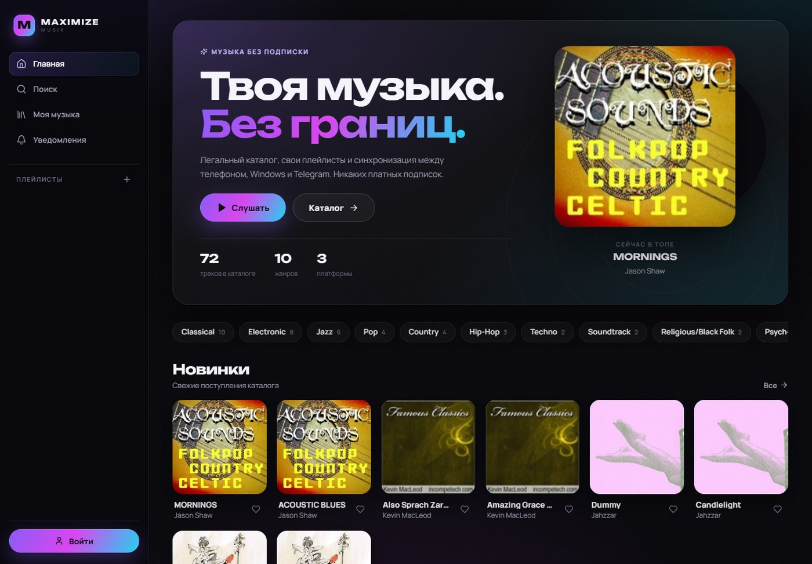
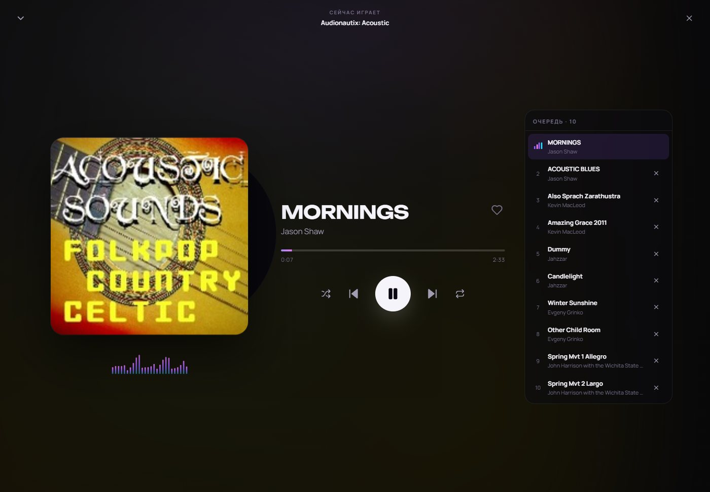
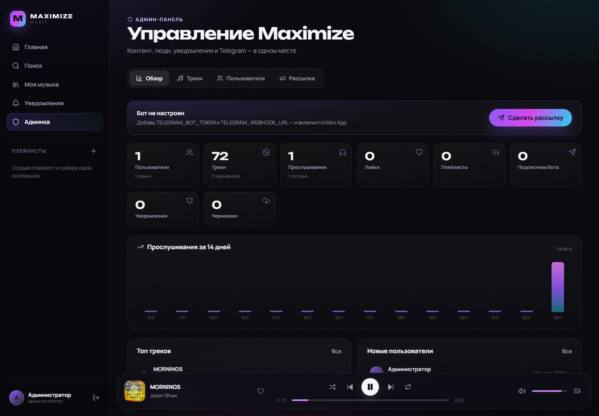
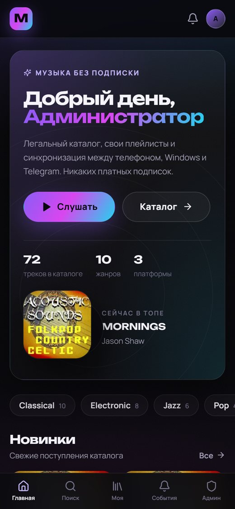
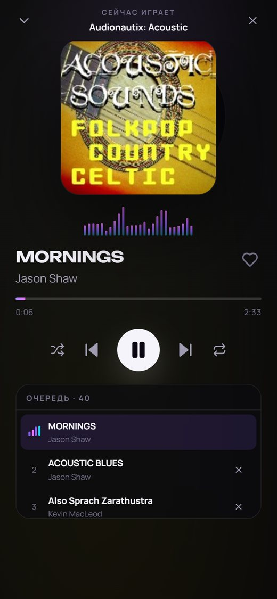
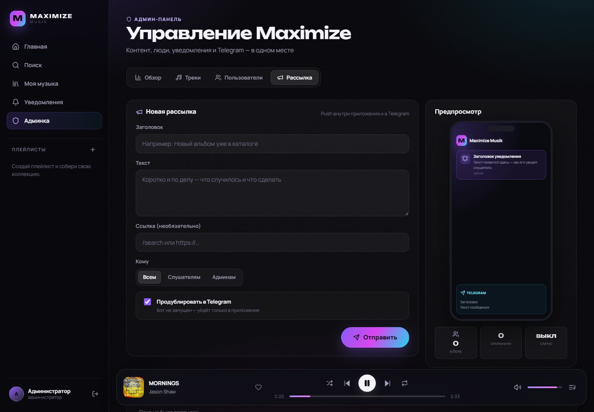

# Maximize Musik

**Музыка без подписки — на телефоне, в Windows и прямо в Telegram.**

**Сайт:** https://ignatkinm00-afk.github.io/maximize-musik/
**APK:** [скачать из Releases](https://github.com/ignatkinm00-afk/maximize-musik/releases/latest)
**Репозиторий:** https://github.com/ignatkinm00-afk/maximize-musik

[](https://render.com/deploy?repo=https://github.com/ignatkinm00-afk/maximize-musik)

> Сайт и APK уже опубликованы, но без backend логин не работает. Нажми кнопку выше —
> Render поднимет API бесплатно за пару минут (нужен только аккаунт Render через GitHub).

Полноценный музыкальный сервис: каталог, поиск, плеер с очередью, лайки, плейлисты,
загрузка своих треков, уведомления, админ-панель и Telegram-бот с Mini App.
Один монорепозиторий — четыре платформы.



| Плеер | Админ-панель |
| --- | --- |
|  |  |

| Телефон | Плеер на телефоне | Рассылки |
| --- | --- | --- |
|  |  |  |

---

## Что внутри

| Платформа | Технологии | Где лежит |
| --- | --- | --- |
| **Веб + PWA** | React 19, TypeScript, Vite, framer-motion | `apps/web` |
| **API** | Fastify 5, SQLite / PostgreSQL, JWT, scrypt | `apps/api` |
| **Windows** | Electron, electron-builder (NSIS + portable) | `apps/desktop` |
| **Android APK** | WebView-оболочка, Gradle, GitHub Actions | `apps/mobile` |
| **Telegram** | grammY, Mini App, проверка `initData` | `apps/api/src/lib/telegram.ts` |

### Возможности

**Слушателю**
- каталог с поиском, жанрами и сортировкой «новинки / топ»;
- плеер: очередь, перемешивание, повтор (очередь/трек), перемотка, громкость;
- **эквалайзер** на 5 полос с пресетами и **усиление громкости до 200%** (с лимитером);
- полноэкранный плеер с анимацией, визуализатором и очередью;
- медиа-клавиши и экран блокировки через Media Session API;
- лайки, история прослушиваний, плейлисты;
- `PWA`: установка на телефон, офлайн-оболочка, ярлыки;
- **Android APK** с тем же интерфейсом (WebView + локальные ассеты);
- **офлайн-музыка из GitHub**: треки из папки `music/` играют прямо с GitHub Pages, без API и VPN;
- регистрация и вход по email или автоматически через Telegram, защита от подбора паролей;
- уведомления в приложении и в Telegram, отметка прочитанного.

**Администратору**
- дашборд: пользователи, треки, прослушивания, лайки, подписчики бота;
- график прослушиваний за 14 дней и топ треков;
- треки: создание по ссылке, публикация/снятие, удаление;
- пользователи: роли, блокировка, поиск;
- рассылки: аудитория (все / слушатели / админы), каналы (приложение / Telegram),
  предпросмотр на «телефоне», история со счётчиками доставки;
- загрузка файлов пользователями с модерацией.

**Telegram**
- бот с командами `/start`, `/app`, `/help`, `/mute`, `/unmute`;
- Mini App открывается кнопкой прямо в чате;
- вход в Mini App без пароля — подпись `initData` проверяется по HMAC-SHA256;
- рассылки из админки дублируются подписчикам бота.

---

## Быстрый старт

Нужен **Node.js 24+** (используются нативный запуск TypeScript и встроенный `node:sqlite`).
Ни Docker, ни PostgreSQL для локального запуска не нужны.

```bash
git clone https://github.com/ignatkinm00-afk/maximize-musik.git
cd maximize-musik
npm install
cp .env.example .env      # Windows: copy .env.example .env
npm run dev
```

Открой **http://localhost:5173**.

Демо-админ (создаётся при первом запуске):

```
admin@maximize.local
admin12345
```

> Смени пароль и `JWT_SECRET` перед публикацией. Данные лежат в `apps/api/data/app.db`,
> каталог из 72 свободных треков уже в репозитории — интернет для запуска не обязателен.

### Полезные команды

| Команда | Что делает |
| --- | --- |
| `npm run dev` | API (`:8787`) + веб (`:5173`) одновременно |
| `npm run dev:api` | только API |
| `npm run dev:web` | только фронтенд (ожидает API на `:8787`) |
| `npm run build` | production-сборка веба в `apps/web/dist` |
| `npm run preview` | раздать собранный веб + проксировать API на `:5173` |
| `npm run build:win` | собрать `.exe` установщик и portable в `apps/desktop/release` |
| `npm run seed` | пересобрать каталог из Internet Archive (Free Music Archive) |
| `npm run music:add -- "C:\Music"` | добавить свои файлы в GitHub-каталог (флаг `--push` — сразу запушить) |
| `npm run test:api` | интеграционные проверки API (нужен запущенный сервер) |
| `npm run typecheck` | проверка типов API и веба |

---

## Архитектура

```
┌──────────────────────────┐      ┌──────────────────────────┐
│  Телефон / браузер (PWA) │      │  Windows (Electron)      │
│  React + Vite            │      │  тот же билд + оболочка  │
└────────────┬─────────────┘      └────────────┬─────────────┘
             │  HTTPS / REST + JWT             │
             ▼                                 ▼
      ┌───────────────────────────────────────────────┐
      │              Fastify API (Node 24)            │
      │  авторизация · каталог · плейлисты · рассылки │
      │  стриминг с range-запросами · загрузки        │
      └───────┬───────────────────────┬───────────────┘
              │                       │
       SQLite локально          PostgreSQL (Supabase)
       /data/app.db             в продакшене
              │                       │
              └──────────┬────────────┘
                         │
              ┌──────────▼──────────┐        ┌────────────────────┐
              │  Telegram Bot       │◀──────▶│  Telegram Mini App │
              │  grammY, webhook    │        │  тот же веб-билд   │
              └─────────────────────┘        └────────────────────┘
```

```
maximize-musik/
├─ apps/
│  ├─ api/                 # Fastify API, бот, сид каталога, SQL-схема
│  │  └─ src/db/catalog.json   # 72 трека со свободной лицензией
│  ├─ web/                 # React PWA: плеер, библиотека, админка
│  └─ desktop/             # Electron-обёртка и electron-builder
├─ docs/                   # скриншоты
├─ scripts/dev.mjs         # параллельный запуск API + Vite
├─ tools/                  # генерация иконок, проверки UI, статический preview
├─ Dockerfile              # образ API для Render / VPS
├─ render.yaml             # blueprints для Render
└─ .github/workflows/      # CI и деплой GitHub Pages
```

### Как хранится музыка

Каталог собирается из нескольких легальных источников — все треки попадают в одну таблицу,
поэтому поиск, плейлисты и плеер работают одинаково:

1. **Audius API** — до ~200 треков из `tracks/trending` (неделя + месяц).
2. **Jamendo** — до 200 треков с CC-лицензиями (нужен бесплатный `JAMENDO_CLIENT_ID`).
3. **Free Music Archive** — локальный `catalog.json` (Creative Commons), работает без сети.

При первом запуске сервер пробует источники по порядку и берёт первый, который отдал
достаточно треков. Audius может блокировать отдельные страны и дата-центры (Cloudflare 403) —
тогда автоматически включается Jamendo или локальный фолбэк. В админке (**Треки → Импорт**)
можно вручную импортировать любой источник: дубликаты по ссылке на аудио отсекаются.

API проксирует аудио через `/api/tracks/:id/stream` с поддержкой `Range` — работают
перемотка и стриминг без CORS-проблем. Обложки внешних каталогов тоже идут через API
(`/api/tracks/:id/cover`), поэтому браузер и APK не обращаются к внешним CDN — только
к твоему серверу. Ссылки Audius отдают 302 на CDN, прокси это корректно обрабатывает.

### Своя музыка в репозитории (без API и VPN)

Если не хочется зависеть от backend и хранилищ — музыку можно положить прямо в GitHub:

```bash
npm run music:add -- "C:\Users\Digma\Music" --push
```

Скрипт скопирует файлы в `apps/web/public/music`, вытащит теги, длительность и обложки,
обновит `music/catalog.json`, сделает коммит и запушит. На сайте появится раздел
**«Офлайн»**, который играет эти треки прямо с GitHub Pages — без API, Supabase и VPN.
Главная тоже умеет показывать этот каталог, если сервер недоступен.

Ограничения GitHub: репозиторий рекомендуется до 1 ГБ, файл — до 100 МБ, трафик Pages
~100 ГБ/мес. Для большой библиотеки лучше Supabase Storage. В APK музыка не включается,
чтобы не раздувать установщик — офлайн-раздел доступен на сайте и в Windows-сборке.

Пользовательские загрузки по умолчанию хранятся в `apps/api/data/uploads`.
В продакшене подключается хранилище по приоритету: **Cloudflare R2 → Supabase Storage →
локальный диск**. R2 лучше для музыки: 10 ГБ бесплатно и бесплатный исходящий трафик.

### Cloudflare R2 за 5 минут

1. [dash.cloudflare.com](https://dash.cloudflare.com) → **R2** → **Create bucket** →
   имя `maximize-music` (может потребоваться привязать карту).
2. Bucket → **Settings → Public access** → включи **r2.dev** (для теста) или подключи
   свой домен. Скопируй публичный URL — это `R2_PUBLIC_URL`.
3. **Manage R2 API Tokens** → **Create API token** → права **Object Read & Write**,
   ограничь бакетом. Получишь `Access Key ID`, `Secret Access Key` и `Account ID`.
4. Добавь в Render переменные:
   ```
   R2_ACCOUNT_ID=...
   R2_ACCESS_KEY_ID=...
   R2_SECRET_ACCESS_KEY=...
   R2_BUCKET=maximize-music
   R2_PUBLIC_URL=https://pub-xxxx.r2.dev
   ```
5. Перезапусти сервис. Новые загрузки пойдут в R2; старые локальные файлы останутся
   на месте (на бесплатном Render они всё равно не переживают рестарт).

---

## Переменные окружения

Скопируй `.env.example` → `.env`. Все переменные читаются только сервером, кроме
`VITE_API_URL` (адрес API для фронтенда на этапе сборки).

| Переменная | По умолчанию | Зачем |
| --- | --- | --- |
| `PORT` / `HOST` | `8787` / `0.0.0.0` | порт API |
| `JWT_SECRET` | `dev-secret-change-me` | подпись токенов — **смени** |
| `ADMIN_EMAIL` / `ADMIN_PASSWORD` | `admin@maximize.local` / `admin12345` | первый админ |
| `DATABASE_URL` | — | PostgreSQL (Supabase); пусто = SQLite |
| `DATA_DIR` | `apps/api/data` | файлы и SQLite |
| `PUBLIC_API_URL` | `http://localhost:8787` | публичный адрес API (бот, ссылки) |
| `WEB_URL` | `http://localhost:5173` | адрес приложения (кнопка Mini App) |
| `CORS_ORIGINS` | `*` | список origin через запятую |
| `TELEGRAM_BOT_TOKEN` | — | токен от `@BotFather`; пусто = бот выключен |
| `TELEGRAM_WEBHOOK_URL` | — | публичный URL API для webhook (иначе long polling) |
| `TELEGRAM_WEBHOOK_SECRET` | `maximize-webhook` | секрет заголовка Telegram |
| `SUPABASE_URL` / `SUPABASE_SERVICE_KEY` | — | хранение загрузок |
| `SUPABASE_BUCKET` | `maximize-media` | бакет Storage |
| `R2_ACCOUNT_ID` | — | Cloudflare R2: Account ID |
| `R2_ACCESS_KEY_ID` / `R2_SECRET_ACCESS_KEY` | — | Cloudflare R2: ключи API-токена |
| `R2_BUCKET` | `maximize-music` | имя бакета R2 |
| `R2_PUBLIC_URL` | — | публичный домен бакета (`https://pub-….r2.dev`) |
| `AUDIUS_APP_NAME` | `MaximizeMusik` | app_name для Audius API |
| `AUDIUS_API_BASE` | `https://api.audius.co` | базовый URL Audius |
| `JAMENDO_CLIENT_ID` | — | бесплатный ключ Jamendo, включает источник |
| `VITE_API_URL` | — | адрес API для веб-сборки (GitHub Pages) |

---

## Деплой бесплатно

Схема: **Supabase** — база и файлы, **Render** — API и бот, **GitHub Pages** — сайт.
Всё на бесплатных тарифах.

### 1. Supabase (PostgreSQL)

1. Создай проект на [supabase.com](https://supabase.com) (Free).
2. `Project Settings → Database → Connection string → URI` — скопируй строку
   **Session pooler** (IPv4, порт 5432/6543).
3. Подставь пароль БД в строку. Это твой `DATABASE_URL`.
4. (Опционально, для загрузок) `Storage → New bucket` → имя `maximize-media`,
   **Public bucket**. Затем `Project Settings → API` → `service_role` ключ и URL —
   это `SUPABASE_SERVICE_KEY` и `SUPABASE_URL`.

Схема таблиц создастся автоматически при старте API.

### 2. Render (API + бот)

1. Запушь репозиторий на GitHub.
2. [render.com](https://render.com) → **New → Blueprint** → выбери репозиторий.
   Render прочитает `render.yaml` и создаст сервис `maximize-musik-api` (Docker, Free).
3. Заполни переменные:
   - `DATABASE_URL` — из Supabase;
   - `ADMIN_PASSWORD` — свой пароль админа;
   - `PUBLIC_API_URL` — `https://maximize-musik-api.onrender.com` (твой URL Render);
   - `WEB_URL` — адрес сайта с GitHub Pages (`https://USER.github.io/REPO/`);
   - `TELEGRAM_BOT_TOKEN` и `TELEGRAM_WEBHOOK_URL` (тот же URL Render);
   - опционально `SUPABASE_*` для хранения загрузок.
4. Проверь `https://…onrender.com/api/health` — должно быть `{"ok":true,...}`.

> Бесплатный Render засыпает после ~15 минут простоя: первый запрос может занять
> 30–60 секунд. Это нормально для демо.

### 3. GitHub Pages (сайт)

1. В репозитории: `Settings → Pages → Build and deployment → Source: GitHub Actions`.
2. `Settings → Secrets and variables → Actions → Variables` → создай
   **`VITE_API_URL`** = адрес API из Render (без слэша в конце).
3. Запушь в `main` — workflow `Deploy web` соберёт PWA с правильным base-путём
   `/<repo>/` и опубликует сайт.
4. Открой `https://USER.github.io/REPO/`.

Workflow сам подставляет `VITE_BASE=/<имя-репозитория>/`. Если репозиторий называется
иначе, ничего менять не нужно.

### 4. Telegram-бот и Mini App

1. `@BotFather` → `/newbot` → получи токен → вставь в `TELEGRAM_BOT_TOKEN`.
2. В Render добавь `TELEGRAM_WEBHOOK_URL=https://…onrender.com` и
   `TELEGRAM_WEBHOOK_SECRET` (сгенерируй случайную строку). Перезапусти сервис —
   бот зарегистрирует webhook и напишет в лог `webhook: …/api/telegram/webhook`.
3. `@BotFather` → `/setmenubutton` → URL сайта GitHub Pages. Кнопка меню откроет Mini App.
4. `@BotFather` → `/setcommands`:

   ```
   start - Открыть Maximize Musik
   app - Плеер в Telegram
   mute - Отключить уведомления
   unmute - Включить уведомления
   help - Помощь
   ```

Mini App требует **HTTPS** — GitHub Pages и Render его дают. Локально (`http://localhost`)
кнопка Mini App может не открыться, но веб-версия работает.

### 5. Windows-приложение

```bash
npm run build:win
```

Готовые файлы появятся в `apps/desktop/release`:

- `Maximize-Musik-Setup-1.0.0.exe` — установщик (NSIS);
- `Maximize-Musik-Portable-1.0.0.exe` — портативная версия.

При первом запуске нажми **«Подключить сервер API»** на экране входа и вставь адрес
Render, например `https://maximize-musik-api.onrender.com`. Адрес запомнится в браузере
приложения. Чтобы задать адрес заранее, запусти `.exe` с переменной окружения
`MM_API_URL=https://…`.

Сборка на Windows требует интернет для загрузки Electron и NSIS. Подпись кода не
настроена — SmartScreen может показать предупреждение «Неизвестный издатель».

### 6. Android APK (GitHub Actions)

APK собирается автоматически в GitHub Actions — отдельный Android SDK на компьютере не нужен.

- каждый пуш в `main` → вкладка **Actions → Build Android APK → artifacts** (`maximize-musik-apk`);
- пуш тега `v*` → APK прикрепляется к **Releases** репозитория;
- можно запустить вручную: **Actions → Build Android APK → Run workflow**, при желании указав
  `api_url` (тогда адрес API зашьётся в APK).

Адрес API для APK берётся из переменной репозитория `VITE_API_URL`. Если она пустая, при первом
запуске нажми **«Подключить сервер API»** на экране входа и вставь адрес Render.

Локальная сборка (нужны JDK 21 и Android SDK):

```bash
npm run build          # VITE_BASE=./ для file://
node tools/prepare-android.mjs
gradle -p apps/mobile/android assembleDebug
# APK: apps/mobile/android/app/build/outputs/apk/debug/app-debug.apk
```

APK подписан debug-ключом и ставится на телефон с разрешением «Установка из неизвестных
источников». Для публикации в Google Play понадобится собственный release-keystore.

### 7. Свой VPS (альтернатива)

```bash
docker compose up -d --build
```

API будет на `:8787`, данные — в томе `maximize_data`. Поставь Nginx/Caddy перед
контейнером и HTTPS.

---

## API

Базовый префикс — `/api`. Авторизация: `Authorization: Bearer <token>`.
Ответы и ошибки — JSON; ошибка всегда `{ "error": "...", "code": "..." }`.

| Метод | Путь | Описание |
| --- | --- | --- |
| `GET` | `/health` | статус, версия, число треков |
| `GET` | `/config` | публичная конфигурация и username бота |
| `POST` | `/auth/register` \| `/auth/login` | регистрация / вход |
| `POST` | `/auth/refresh` | обновление access-токена |
| `POST` | `/auth/logout` \| `/auth/logout-all` | выход / выход со всех устройств |
| `POST` | `/auth/telegram` | вход по `initData` Mini App |
| `GET` | `/auth/me` | текущий пользователь |
| `PATCH` | `/auth/me` | имя и цвет аватара |
| `POST` | `/auth/password` | смена пароля |
| `GET` | `/home` | подборки главной |
| `GET` | `/tracks` | поиск, фильтр по жанру, пагинация |
| `GET` | `/tracks/:id` | трек |
| `GET` | `/tracks/:id/stream` | аудио (Range) |
| `POST` | `/tracks/:id/play` | записать прослушивание |
| `GET` | `/genres` | жанры |
| `GET` | `/library/likes` \| `/recent` \| `/uploads` | библиотека |
| `POST` | `/library/likes/:id` | лайк / анлайк |
| `GET`/`POST` | `/library/playlists` | список / создание |
| `GET`/`PATCH`/`DELETE` | `/library/playlists/:id` | плейлист |
| `POST`/`DELETE` | `/library/playlists/:id/tracks[/:trackId]` | треки в плейлисте |
| `POST` | `/tracks/upload` | загрузка своего трека |
| `GET` | `/notifications` | инбокс |
| `GET` | `/notifications/unread-count` | непрочитанные |
| `POST` | `/notifications/:id/read` | прочитано |
| `POST` | `/notifications/read-all` | прочитать всё |
| `GET` | `/admin/stats` | статистика |
| `GET`/`PATCH` | `/admin/users[/:id]` | пользователи и роли |
| `GET`/`POST`/`PATCH`/`DELETE` | `/admin/tracks[/:id]` | управление каталогом |
| `GET`/`POST` | `/admin/notifications` | история и создание рассылки |
| `GET` | `/admin/subscribers` | подписчики бота |
| `POST` | `/telegram/webhook` | webhook Telegram (секретный заголовок) |

---

## Музыка и лицензии

- Источники каталога — **Audius**, **Jamendo** и **Free Music Archive**. У каждого свои
  условия и лицензии; перед коммерческим запуском проверь их и сохраняй атрибуцию.
- Пользовательские загрузки: только своя музыка или файлы со свободной лицензией.
  Пользовательские треки не публикуются без проверки администратором.
- Проект не содержит и не ищет пиратский контент. Ссылки на сторонние каталоги
  подключаются только при наличии прав.

Код открыт по лицензии [MIT](LICENSE).

---

## Безопасность

- регистрация и вход по email, пароли — `scrypt` с солью;
- **короткоживущий access-токен** (2 часа) + **refresh-токен** (30 дней) с ротацией;
  refresh-токены хранятся в базе только в виде SHA-256-хеша;
- смена пароля и бан увеличивают `token_version` и отзывают все сессии;
- **«Выйти со всех устройств»** в настройках;
- политика паролей: минимум 10 символов, буквы и цифры;
- **блокировка после 10 неудачных попыток** входа на 15 минут (по email);
- отдельные лимиты на `/auth/login`, `/auth/register`, `/auth/refresh`, `/auth/telegram`;
- security-заголовки через Helmet (nosniff, frame, referrer-policy, HSTS);
- проверка роли на каждом админ-маршруте, блокировка пользователей;
- ограничение частоты запросов, лимит загрузки 45 МБ, проверка MIME;
- CORS настраивается через `CORS_ORIGINS`, секреты — только в переменных окружения.

Перед продакшеном обязательно: смени `JWT_SECRET`, `ADMIN_PASSWORD`,
`TELEGRAM_WEBHOOK_SECRET`, закрой CORS своим доменом. Токены хранятся в localStorage,
поэтому не подключай сторонние скрипты на страницу приложения.

---

## Roadmap

- плейлисты с обложками и совместным редактированием;
- офлайн-кэш прослушанных треков и скачивание;
- эквалайзер и кроссфейд;
- OAuth (Google/Apple) и восстановление пароля по email;
- рекомендации на основе истории;
- пуш-уведомления в PWA через Web Push;
- монетизация: подписка на эксклюзивы, донаты авторам.

---

Сделано с любовью к музыке и без ежемесячных списаний. 🎧
